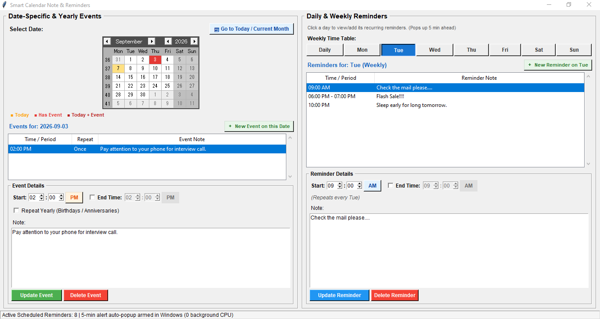

# Smart Calendar & Reminder App

> **A set-and-forget Windows reminder app that never runs in your background. Reliably pops up 5 minutes before daily, weekly, annual, or custom date events using Windows Task Scheduler.**

---



---

## 💡 Overview

Most desktop reminder utilities run continuous background processes or infinite `while` loops, needlessly consuming system memory (RAM) and CPU cycles. 

**Smart Calendar & Reminder App** solves this problem by using a **native OS-level architecture**:
- When you schedule or update an event, the app automatically configures a scheduled job using **Windows Task Scheduler (`schtasks`)**.
- The GUI application closes completely—**0% background CPU and 0 MB RAM footprint**.
- Exactly **5 minutes before your scheduled event**, Windows wakes a lightweight checker that alerts you with sound and a popup dialog.

---

## ✨ Features

- **Zero Background Overhead:** Doesn't stay resident in system memory. Windows handles execution natively.
- **5-Minute Pre-Event Notifications:** Always triggers 5 minutes prior to give you time to prepare.
- **Flexible Recurrence Patterns:**
  - **One-time:** Specific date and time.
  - **Daily:** Recurring at a designated hour every day.
  - **Weekly:** Customizable days of the week (e.g., Monday, Wednesday, Friday).
  - **Annual:** Year-over-year milestones and anniversaries with 7-day advance notice.
- **Bootup Missed Event Check:** On computer startup, it intelligently scans if you missed any event while your PC was powered off.
- **Clean Tkinter GUI:**
  - Built-in monthly calendar picker (`tkcalendar`).
  - 1-click AM/PM time toggle.
  - Duration/end-time support.
  - Easy event search, editing, and deletion.
- **Audio & Visual Prompts:** Uses Windows audio cues (`winsound`) with non-intrusive interactive popups.

---

## 🛠️ Architecture

```
Calendar/
├── editor.py            # Main GUI management interface (Tkinter + tkcalendar)
├── checker.py           # Python notification trigger & alert dialog
├── src/
│   ├── lib.rs           # Zero-CRT Rust checker core & unit tests (builds checker.dll)
│   └── main.rs          # Standalone Zero-CRT Rust entry point (builds checker_ultra.exe)
├── Cargo.toml           # Zero-dependency Rust crate manifest
├── build_checker.bat    # Builds checker.dll & checker_ultra.exe
├── checker_ultra.c      # Reference Zero-CRT C implementation (updated to full parity)
├── scheduler_helper.py  # Backend engine (JSON persistence, recurrence logic, Windows API / schtasks)
├── benchmark.py         # Automated reproducible benchmark test suite
├── BENCHMARK_RESULTS.md # Detailed C vs Rust & Python benchmark report
├── requirements.txt     # Python dependencies
└── reminders.json.example # Sample event structure
```

---

## ⚡ High-Performance Native Rust Checker (`src/lib.rs` & `src/main.rs`)

To eliminate interpreted runtime overhead during Windows startup while guaranteeing memory safety and full logic parity, the project uses a bare-metal **Zero-CRT `#![no_std]` Rust implementation** compiled as both a **standalone executable (`checker_ultra.exe`)** and an **in-process shared library (`checker.dll`)**.

### Why Bare-Metal Zero-CRT Rust?
- **Zero C Runtime (`#![no_std]` + `-nostdlib`):** Zero external crates, no Python VM, no `msvcrt.dll`. Links directly against `kernel32.dll` and `advapi32.dll`.
- **Full Event & Dismissal Parity:** Handles `once`, `daily`, `weekly`, `annual`, and overnight events, lazy-loads `dismissed_today.json` only when a candidate event matches, and uses exact civil-days calendar math (`days_from_civil`).
- **Memory & Bounds Safe + Unit Tested:** Slice-checked JSON parsing (safe against `{}` inside notes and >64 KB files via `HeapAlloc` fallback), `DllMain` `HMODULE` path resolution, and `cargo test --lib` unit tests.
- **Zero AV False Positives:** Runs cleanly without triggering heuristic antivirus alerts.
- **Asynchronous Event 777 Handoff:** Signals Windows Event Log Event ID `777` (`SmartCalendar`) in microseconds and exits immediately so Windows Task Scheduler launches the alert dialog asynchronously.

### 📊 Apples-to-Apples Benchmarks (Zero-CRT Rust vs Fixed Zero-CRT C vs Python)

> 💡 **Why Process Lifetime & Memory Release Matter:**  
> The faster a bootup checker exits, the faster 100% of its working set and OS handles are released back to Windows.

#### Scenario 1: Missed Event Detected (Event 777 Dispatched)

| Implementation | Binary Size | Process Lifetime / Load-to-Exit | Internal Execution | Correctness (6/6) |
| :--- | :--- | :--- | :--- | :--- |
| **PyInstaller (`AutoChecker.exe`)** | ~11.2 MB | ~1,519.7 ms *(~1.52 s)* | — | ✅ |
| **Raw Python (`checker.py`)** | 12.1 KB | ~174.9 ms | — | ✅ |
| **Fixed Zero-CRT C (`checker_ultra.exe`)** | 24.5 KB | `11.87 ms` median (`11.11 ms` min) | — | ✅ 6 / 6 |
| **Zero-CRT Rust (`checker_ultra.exe`)** | 28.2 KB | **`11.43 ms` median (`11.18 ms` min)** | — | ✅ 6 / 6 |
| **Fixed Zero-CRT C (`checker.dll`)** | 24.5 KB | **`1,229.7 µs` median** | **`747.3 µs` median** | ✅ 6 / 6 |
| **Zero-CRT Rust (`checker.dll`)** | 201.7 KB | `1,362.6 µs` median | `801.2 µs` median | ✅ 6 / 6 |

#### Scenario 2: Quiet Bootup / No Event Detected (95%+ of System Boots)

| Implementation | Binary Size | Process Lifetime / Load-to-Exit | Internal Execution | Correctness (6/6) |
| :--- | :--- | :--- | :--- | :--- |
| **PyInstaller (`AutoChecker.exe`)** | ~11.2 MB | ~1,392.5 ms *(~1.39 s)* | — | ✅ |
| **Raw Python (`checker.py`)** | 12.1 KB | ~66.1 ms | — | ✅ |
| **Fixed Zero-CRT C (`checker_ultra.exe`)** | 24.5 KB | `9.48 ms` median (`8.78 ms` min) | — | ✅ 6 / 6 |
| **Zero-CRT Rust (`checker_ultra.exe`)** | 28.2 KB | **`9.15 ms` median (`8.82 ms` min)** | — | ✅ 6 / 6 |
| **Fixed Zero-CRT C (`checker.dll`)** | 24.5 KB | **`385.0 µs` median** | `108.1 µs` median | ✅ 6 / 6 |
| **Zero-CRT Rust (`checker.dll`)** | 201.7 KB | `389.6 µs` median | **`106.0 µs` median** | ✅ 6 / 6 |

### Compiling the Native Checker (Zero-CRT Rust)

Both the standalone `.exe` and the in-process `.dll` are built from [`src/lib.rs`](src/lib.rs) and [`src/main.rs`](src/main.rs) (`#![no_std]`, zero external crates):

```cmd
build_checker.bat
```

See [`BENCHMARK_RESULTS.md`](BENCHMARK_RESULTS.md) for the full apples-to-apples Fixed C vs Optimized Rust benchmark comparison (~9.15 ms EXE lifetime, ~106 µs DLL internal / ~390 µs load-to-exit, 6/6 correctness parity).

### 🧪 Reproducing the Benchmarks

You can execute the automated benchmark suite directly on your machine:

```bash
python benchmark.py
```

*For complete run-by-run tables, QPC CPU hardware cycle analysis, and testing methodology, see [`BENCHMARK_RESULTS.md`](BENCHMARK_RESULTS.md).*

---

## 🚀 Getting Started

### Prerequisites
* Windows 10 / 11
* Python 3.9+

### Installation

1. Clone the repository:
   ```bash
   git clone https://github.com/YuriSekaii/smart-calendar-reminder.git
   cd smart-calendar-reminder
   ```

2. Install dependencies:
   ```bash
   pip install -r requirements.txt
   ```

3. Launch the Calendar Editor:
   ```bash
   python editor.py
   ```

---

## 📦 Building Standalone Executables (Optional)

If you want to package the app into standalone Windows executables without requiring a Python environment:

```bash
pip install pyinstaller

# Build the GUI Editor
pyinstaller --noconsole --onefile editor.py -n MyCalendarApp

# Build the Background Checker
pyinstaller --noconsole --onefile checker.py -n AutoChecker
```

---

## 📄 License

This project is licensed under the MIT License.
